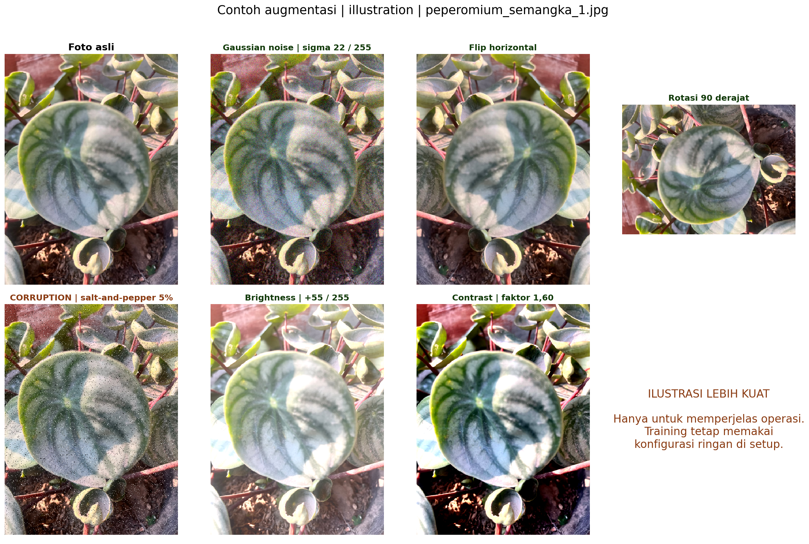
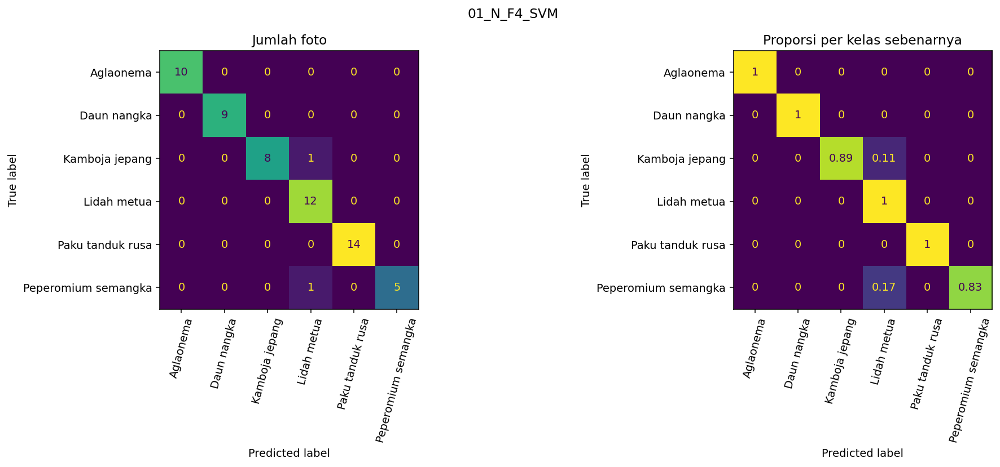
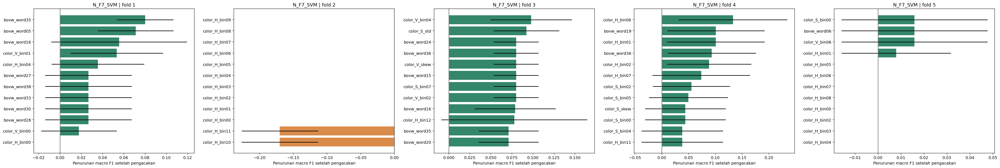

# Klasifikasi Tanaman dari Citra Daun

**EDA dan studi ablasi pengolahan citra, fitur visual, serta machine learning klasik.**

Repositori ini mendokumentasikan eksperimen klasifikasi 6 kelas tanaman dari 60 citra daun. Sebanyak **108 kombinasi** dibandingkan untuk setiap skenario: 6 kondisi citra × 9 paket fitur × 2 model. Tersedia hasil baseline dan augmentasi, prediksi out-of-fold (OOF), analisis kesalahan, dan feature importance.

**Hasil utama:** konfigurasi citra tanpa enhancement/segmentasi (`N`) dengan SVM dan fitur warna + SIFT–BoVW (`F4`) mencapai akurasi OOF **96,67% (58/60 foto benar)** pada skenario augmentasi. Rata-rata macro-F1 pada 5 outer fold adalah **0,9444 ± 0,1242**. Hasil ini masih eksploratif pada tingkat foto, dengan keterbatasan yang dijelaskan di bawah.

[Buka notebook](Notebook/EDA_Ablasi_ML_Daun.ipynb) · [Hasil baseline](Notebook/hasil_ml_full/) · [Hasil augmentasi](Notebook/hasil_ml_full_aug/)

## Tujuan eksperimen

- Mengamati distribusi kelas, karakteristik citra, dan duplikat piksel melalui EDA.
- Membandingkan enhancement CLAHE, segmentasi Otsu, dan segmentasi K-Means.
- Mengukur kontribusi warna, Sobel, Canny, dan SIFT–Bag of Visual Words (BoVW).
- Membandingkan Support Vector Machine (SVM) dan Random Forest (RF) dengan nested cross-validation.
- Menelaah dampak augmentasi train-only, kesalahan klasifikasi, dan kontribusi blok fitur.

## Data

Audit yang tersimpan mencakup 60 citra berukuran 960 × 1280 piksel, tanpa duplikat piksel identik.

| Label pada metadata | Jumlah citra |
|---|---:|
| Aglaonema | 10 |
| Daun nangka | 9 |
| Kamboja jepang | 9 |
| Lidah metua | 12 |
| Paku tanduk rusa | 14 |
| Peperomium semangka | 6 |
| **Total** | **60** |

Nama kelas dipertahankan sesuai metadata eksperimen. **Dataset mentah tidak disertakan.** Gambar contoh yang telah menjadi bagian output notebook tetap tersedia dalam artefak hasil.

## Rancangan ablasi

### Kondisi citra

| Kode | Perlakuan |
|---|---|
| `N` | Tanpa enhancement atau segmentasi |
| `E` | Enhancement CLAHE pada kanal L* di ruang Lab |
| `S-O` | Segmentasi Otsu pada kanal a* Lab |
| `S-K` | Segmentasi K-Means di ruang Lab |
| `E-S-O` | CLAHE dilanjutkan segmentasi Otsu |
| `E-S-K` | CLAHE dilanjutkan segmentasi K-Means |

Parameter awal PCD: CLAHE clip limit 1,5 dengan tile 8 × 8, K-Means dengan 4 cluster, serta operasi morfologi opening/closing dengan kernel elips 3 × 3. Parameter ini dibekukan sebagai kandidat awal, bukan diklaim sebagai konfigurasi PCD terbaik. Sisi terpanjang citra pada full mode dibatasi 640 piksel.

### Paket fitur

| Paket | Fitur |
|---|---|
| `F0` | Warna |
| `F1` | Warna + Sobel |
| `F2` | Warna + Canny |
| `F3` | SIFT–BoVW |
| `F4` | Warna + SIFT–BoVW |
| `F5` | Canny + SIFT–BoVW |
| `F6` | Sobel + SIFT–BoVW |
| `F7` | Warna + Canny + SIFT–BoVW |
| `F8` | Warna + Sobel + SIFT–BoVW |

Warna direpresentasikan oleh histogram HSV dan statistik S/V. Sobel dan Canny menghasilkan statistik serta histogram arah gradien. Deskriptor SIFT dikodekan menjadi histogram BoVW; kamusnya dipelajari hanya dari citra asli pada subset train. Profil ekstraksi menentukan jumlah bin warna, ukuran kamus BoVW, dan threshold Canny sehingga dimensi fitur dapat berbeda antarfold.

### Model dan evaluasi

- **Nested CV:** 5 outer fold untuk evaluasi dan 3 inner fold untuk pemilihan parameter, dengan seed 42. Pada data ini, setiap outer fold berisi 48 foto train dan 12 foto evaluasi.
- **Model:** SVM RBF dan Random Forest dengan 200 pohon; masing-masing memakai 9 kandidat hyperparameter pada full mode.
- **Profil fitur:** dipilih melalui inner CV dengan anchor `N–F8–SVM`, lalu digunakan bersama oleh seluruh 108 kombinasi dalam outer fold yang sama.
- **Kontrol kebocoran:** imputer, scaler, model, dan kamus BoVW di-fit dari train. Validation dan outer-evaluation tetap berupa foto asli. Dukungan split berbasis `plant_id` tersedia jika metadata individu tanaman lengkap.
- **Artefak evaluasi:** setiap skenario menghasilkan 540 baris metrik fold dan 6.480 prediksi OOF, yaitu satu prediksi per foto untuk setiap kombinasi.

## Augmentasi

Skenario augmentasi menambahkan satu varian untuk masing-masing dari enam operasi: Gaussian noise, flip horizontal/vertikal, rotasi 90°/180°/270°, salt-and-pepper corruption, brightness, dan contrast. Dengan citra asli, satu foto train menghasilkan 7 sampel; 48 foto outer-train menjadi 336 sampel untuk fitting.

Augmentasi dilakukan **hanya pada train**, termasuk inner-train saat tuning. Gaussian noise memakai sigma 3–10, corruption fraction 0,002–0,008, brightness ±10–20, dan contrast factor 0,85–1,15. Konfigurasi lengkap tersedia di [augmentation_config.json](Notebook/hasil_ml_full_aug/augmentation_config.json).



Panel di atas memakai mode **illustration** yang memperkuat efek untuk keperluan visualisasi. Intensitas pada panel ini tidak boleh dianggap sebagai parameter training; acuannya adalah konfigurasi JSON dan kode `augment_rgb`.

## Hasil eksperimen

Empat konfigurasi teratas dari masing-masing `summary_108.csv`:

| Skenario | Input | Paket | Model | Macro-F1, mean ± SD fold | Akurasi rata-rata fold |
|---|---|---|---|---:|---:|
| Baseline | `E` | `F4` | SVM | 0,9311 ± 0,1203 | 95,00% |
| Baseline | `N` | `F4` | SVM | 0,9311 ± 0,1203 | 95,00% |
| Baseline | `N` | `F7` | SVM | 0,9311 ± 0,1203 | 95,00% |
| Baseline | `N` | `F8` | SVM | 0,9311 ± 0,1203 | 95,00% |
| Augmentasi | `N` | `F4` | SVM | 0,9444 ± 0,1242 | 96,67% |
| Augmentasi | `N` | `F7` | SVM | 0,9444 ± 0,1242 | 96,67% |
| Augmentasi | `N` | `F8` | SVM | 0,9444 ± 0,1242 | 96,67% |
| Augmentasi | `N` | `F5` | SVM | 0,9300 ± 0,0741 | 93,33% |

Sumber: [ranking baseline](Notebook/hasil_ml_full/summary_108.csv) dan [ranking augmentasi](Notebook/hasil_ml_full_aug/summary_108.csv). Skor seri tidak menunjukkan satu konfigurasi lebih unggul dari konfigurasi lain.

Untuk `N–F4–SVM`, baseline menghasilkan 57/60 prediksi benar dan augmentasi 58/60. Macro-F1 yang dihitung dari **seluruh prediksi OOF yang digabung** masing-masing adalah **0,9473** dan **0,9622**. Nilai ini berbeda dari rata-rata macro-F1 antarfold pada tabel karena macro-F1 bukan metrik yang linear. SD pada tabel adalah variasi antarfold, bukan confidence interval.

Temuan deskriptif dari hasil tersebut:

- Warna + SIFT–BoVW (`F4`) menyamai skor paket `F7` dan `F8` yang menambahkan fitur edge pada konfigurasi teratas.
- Konfigurasi tanpa enhancement/segmentasi (`N`) termasuk yang terbaik; hasil ini belum menunjukkan kebutuhan segmentasi untuk mencapai skor tertinggi pada data yang tersedia.
- Skor terbaik skenario augmentasi lebih tinggi daripada baseline. Profil fitur dipilih ulang dalam tiap skenario, sehingga perbedaan tersebut mencerminkan keseluruhan prosedur, bukan isolasi efek augmentasi dengan profil tetap.

### Analisis kesalahan

Pada `N–F4–SVM` dengan augmentasi, dua foto yang salah diklasifikasikan adalah:

| Foto | Label sebenarnya | Prediksi |
|---|---|---|
| `kamboja_jepang_2.jpg` | Kamboja jepang | Lidah metua |
| `peperomium_semangka_3.jpg` | Peperomium semangka | Lidah metua |



Confusion matrix menampilkan hitungan absolut dan normalisasi per kelas. Laporan per kelas, contoh foto salah, dan perbandingan prediksi tersedia di [analisis empat konfigurasi teratas](Notebook/hasil_ml_full_aug/error_analysis_top4/).

### Feature importance

Permutation importance mengukur penurunan macro-F1 ketika fitur atau blok fitur diacak pada outer-evaluation. Analisis tambahan disediakan untuk `N–F7–SVM` dan `N–F8–SVM`, yang menyamai skor tertinggi selain `F4`.



Lihat [ringkasan importance per blok](Notebook/hasil_ml_full_aug/feature_importance_best_non_f4/block_importance_summary.csv). Importance bersifat deskriptif, bukan kausal; fitur berkorelasi dapat saling menggantikan. Indeks word BoVW tidak dibandingkan langsung antarfold karena kamusnya berbeda.

## Struktur repositori

```text
leaf-classification-ablation/
├── README.md
└── Notebook/
    ├── EDA_Ablasi_ML_Daun.ipynb
    ├── hasil_ml_full/                 # Baseline tanpa augmentasi
    │   ├── summary_108.csv
    │   ├── metrics_per_fold.csv
    │   ├── oof_predictions.csv
    │   ├── paired_deltas.csv
    │   ├── error_analysis_top4/
    │   ├── feature_importance_best_non_f4/
    │   └── ...
    └── hasil_ml_full_aug/             # Eksperimen dengan augmentasi train-only
        ├── augmentation_config.json
        ├── summary_108.csv
        ├── metrics_per_fold.csv
        ├── oof_predictions.csv
        ├── paired_deltas.csv
        ├── error_analysis_top4/
        ├── feature_importance_best_non_f4/
        └── ...
```

### Panduan artefak

Nama di bawah berlaku pada kedua folder hasil, kecuali jika disebutkan khusus.

| Berkas/folder | Isi |
|---|---|
| `summary_108.csv` | Ranking 108 kombinasi berdasarkan rata-rata macro-F1 |
| `metrics_per_fold.csv` | Skor, parameter, profil, dan timing setiap outer fold |
| `oof_predictions.csv` | Label sebenarnya dan prediksi OOF setiap foto |
| `paired_deltas.csv` | Selisih skor perlakuan pada fold, model, dan paket/input yang sama |
| `splits.csv` | Pembagian train dan evaluation per outer fold |
| `inner_tuning.csv`, `selected_profiles.json` | Hasil pencarian hyperparameter dan profil terpilih |
| `manifest_audit.csv` | Metadata citra, dimensi, brightness, blur, dan hash piksel |
| `qc_pcd.csv`, `feature_qc_profile0.csv` | Audit mask dan ketersediaan fitur |
| `error_analysis_top4/` | Analisis per kelas, confusion matrix, dan contoh kesalahan |
| `block_importance.csv`, `permutation_importance_by_fold.csv` | Importance blok dan fitur per fold |
| `feature_importance_best_non_f4/` | Analisis tambahan konfigurasi terbaik selain F4 |
| `hasil_ml_full/environment.json` | Catatan environment eksekusi baseline |

Path absolut pada artefak audit dan output notebook merupakan catatan mesin eksekusi lama. Path tersebut tidak diperlukan untuk membaca tabel hasil.

## Membaca dan menjalankan notebook

**Membaca hasil:** buka notebook di GitHub atau unduh dan buka secara lokal. Output eksekusi sudah tersimpan; CSV dan PNG dapat dibaca tanpa dataset atau training ulang.

**Menjalankan ulang:** sediakan dataset sendiri dengan struktur berikut pada root repo lokal. Dataset ini tidak termasuk dalam repositori.

```text
Dataset/
├── metadata.csv
├── Aglaonema/
│   └── aglaonema_1.jpg
└── <label lain>/
    └── <nama citra>
```

`metadata.csv` wajib memiliki kolom `image` dan `label`. Setiap citra dibaca dari `Dataset/<label>/<image>`. Jika memakai `plant_id`, kolom harus lengkap dan jumlah grup harus mencukupi untuk seluruh fold. Jika kolom `status_QC_label` tersedia, semua nilainya harus `approved`.

Siapkan environment Python dan dependensi:

```bash
python -m venv .venv
source .venv/bin/activate
# Windows PowerShell: .venv\Scripts\Activate.ps1
python -m pip install numpy pandas matplotlib pillow opencv-python scikit-learn threadpoolctl jupyterlab ipywidgets
python -m jupyterlab Notebook/EDA_Ablasi_ML_Daun.ipynb
```

Environment yang tercatat menggunakan Python 3.10.20, scikit-learn 1.7.2, dan OpenCV 5.0.0. Perintah instalasi di atas tidak mengunci versi; reproduksi angka yang sama belum dijamin untuk environment lain. Notebook menggunakan CPU dan tidak memerlukan PyTorch/CUDA.

Jalankan notebook dari root repo atau folder `Notebook`, lalu atur cell setup:

```python
SMOKE_TEST = False
SEED = 42
AUGMENTATION_ENABLED = True   # False untuk baseline
```

Dengan pengaturan ini, output ditulis ke `Notebook/hasil_ml_full_aug/`; baseline memakai `Notebook/hasil_ml_full/`. `SMOKE_TEST=True` memakai konfigurasi ringkas untuk memeriksa alur dan bukan benchmark final. Menjalankan ulang menulis ke folder hasil sesuai konfigurasi, sehingga simpan salinan hasil lama jika diperlukan.

Cell error analysis 7b dapat membaca CSV tersimpan tanpa training ulang. Cell feature importance 8 dan 8b membutuhkan objek model serta cache dari kernel training yang masih aktif. Beberapa narasi markdown lama pada notebook belum mengikuti penambahan augmentasi; konfigurasi aktif dan prosedur yang dijelaskan README ini mengacu pada kode serta CSV hasil, termasuk anchor `N–F8–SVM`.

## Batasan interpretasi

- Dataset kecil dan jumlah citra tiap kelas tidak seimbang. Satu kesalahan dapat memengaruhi skor kelas secara nyata.
- Hasil yang tersimpan memakai evaluasi tingkat foto karena `plant_id` tidak tersedia. Foto dari tanaman yang sama atau terkait dapat berada pada fold berbeda walaupun tidak identik secara piksel.
- `status_QC_label` belum tersedia pada data eksperimen; hasil masih provisional dan identitas botani belum divalidasi melalui protokol label independen.
- Ranking 108 kombinasi bersifat deskriptif. Skor konfigurasi yang dipilih setelah melihat OOF dapat optimistis; konfirmasi membutuhkan test set dari individu tanaman yang benar-benar terpisah.
- Augmentasi menambah variasi foto train, bukan jumlah individu tanaman independen.
- Segmentasi menggunakan prior warna, bukan deteksi semantik daun. Tidak tersedia ground truth mask untuk menyimpulkan IoU/Dice atau akurasi segmentasi.
- Timing berasal dari pengukuran komponen dan cache pada mesin eksperimen; tidak merepresentasikan benchmark deployment yang stabil.

Repositori ini menyimpan notebook dan artefak eksperimen, bukan model siap deployment. Notebook beserta output aslinya dipertahankan tanpa training ulang saat penyusunan dokumentasi ini.
